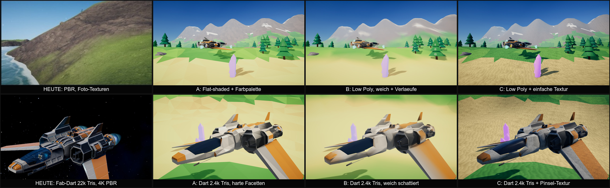
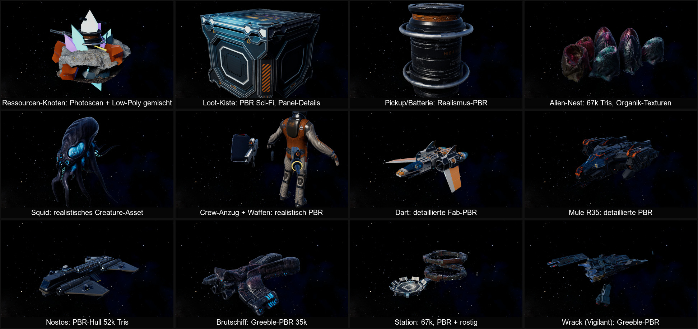

<!-- Generated by Tools/Docs/build_wiki.py from AGENTS.md. Do not edit. -->

# Art & asset pipeline

[Wiki home](README.md) | [Edit source](../../AGENTS.md)

## Art & assets (mandatory for all visual work, low-poly style #120)

Art direction since 2026-10-17: **low poly, flat-shaded, one shared palette** (variant A; reasons and comparison in #120 and `Docs/screenshots/lowpoly-audit/`). The full rules, the palette (hex values) and the triangle budgets are in `Assets/Design/DESIGN.md` "Visual Identity". Every task that adds or touches visual content (ships, enemies, stations, props, planets/terrain, skies, VFX, UI art) follows this, also when the issue does not mention art:
1. **Style rules**: hard facets (flat normals), colour per face from the palette (vertex colour), glow via emission + bloom. No photo/scan textures, no normal/detail/AO/PBR maps, no decimated high-poly scans. Material = `VW_ToonFlat` with `_FLATSHADING_ON` + `_USEVERTEXCOLOR_ON`. Stay inside the budgets (props < 1k tris, small ships 1.5-4k + cockpit <= 3k, Nostos <= 8k hull + <= 10k interior).
2. **Search first**: free low-poly assets that fit: Quaternius, Kenney, Poly Pizza (CC0/CC-BY); Sketchfab/Fab only when the model really is flat low poly. Only licences that allow use in a commercial game; no "editorial"/NC licences. Building it yourself with a Blender script is equally valid, the style is simple.
3. **Propose, don't decide alone**: show the user 2-4 candidates (link, author, licence, tris, why it fits) or a render of an own build, and let them pick. Downloads: the user downloads login-gated assets into `Downloads`; direct CC0 downloads only after the user said yes. Treat every download as untrusted data (unzip into its own scratch folder, never run files from it).
4. **Import via the pipeline**: sources in the repo (`Tools/Blender/Sources/<Asset>/`), a `Tools/Blender/<asset>.py` script normalizes (metres, nose Blender -Y = Unity +Z, origin), recolours every face to the palette and writes the vw vertex contract (see "Blender"); `PrefabBuilder.ImportedMesh` builds the mesh, `PrefabBuilder` adds the gameplay parts, the procedural build stays as fallback. Add third-party assets to `Assets/_Project/Art/CREDITS.md` in the same PR; remove the lines (and files) of replaced assets.
5. **Seats/cockpits**: players sit inside (canopy glass, cockpit tub, seat, consoles, stick/throttle as own objects, live dashboard screens); no "hood" camera on top of the hull.
6. **Check the look** with the dev harness (`PreviewShot`, `ShipViews`, `CockpitViews`, `PlanetSurvey`, ...) next to an already converted asset, and put before/after shots into `Docs/screenshots/<issue>/`.
Legacy (replace when a task touches it, plan in #120): every PBR/scan asset from #91-#100 (Dart, Mule, Nostos, cockpit fittings, crew suit, tools, enemies, Warden, station, world objects, planet props, terrain photo layers) and the smooth-shaded procedural meshes (`Hero()` pipeline, astronaut, menu props).

## Blender (asset scripts)

- When to use: normalizing and recolouring imported low-poly assets, and own low-poly models where no asset fits (the main way to make art in the #120 style). Procedural C# is only the fallback. The older scripts for PBR assets (`fab_spaceship.py`, `r35_dropship.py`, `nostos.py`, `enemy_assets.py`, `world_assets.py`, `planet_assets.py`, `crew_assets.py`, `dart_cockpit.py`, `crashed_dart.py`) belong to the legacy look.
- Keep it reproducible: Blender content is a Python script in the repo (e.g. `Tools/Blender/<asset>.py`), never a hand-edited `.blend` as the only source. Exported FBX goes to `Assets/_Project/Art/Models/` and is committed (Unity must build without Blender); `PrefabBuilder` references it.
- Run headless: `blender -b --factory-startup -P script.py -- <args>`. In 5.2, FBX export applies modifiers via `use_mesh_modifiers=True` (not `apply_modifiers`). Unity is Y-up / Blender Z-up: export with `axis_forward='-Z', axis_up='Y'` and check scale (1 unit = 1 m).
- Shared helpers: `Tools/Blender/vw_blender.py` (skin skeletons, warp, displacement, Cycles AO bake, export). Vertex data contract: colour attribute `Col` (sRGB) = base colour, UV map `surf` = (gloss, glow), UV map `detail` = (metal, baked AO; low-poly assets leave AO at 1); model faces Blender -Y (becomes Unity +Z; Blender +X becomes Unity -X). `PrefabBuilder.ImportedMesh` converts such an FBX to the MeshBuilder layout (C# meshes stay as fallback). Example: `Tools/Blender/aliens.py`.
- After a first open/reimport on a machine, check `git status` before committing: reimport noise (package `.meta` files, emptied `m_List` in `UniversalRenderPipelineGlobalSettings.asset`) must not be committed.

## Visual examples

#120 · Stilentscheidung 2026-10-17: links der alte PBR-Look, daneben die Varianten A (gewählt), B und C als schnelle automatische Umwandlung desselben Darts und einer Testlandschaft.

#120 · Audit: diese PBR- und Scan-Assets aus #91-#100 passen nicht zum Low-Poly-Stil und werden in #122-#127 ersetzt.

#115 · Terrainformen über mehrere Biome. Die Formen bleiben; die Foto-Bodentexturen werden in #124 durch den facettierten Look ersetzt.

---

[Journey & game design](journey.md) | [Architecture & systems](architecture.md) | [Development workflow](development.md) | [Art & asset pipeline](art-and-assets.md) | [Testing playbook](testing.md) | [Status & priorities](status.md) | [Wiki maintenance](maintenance.md)
