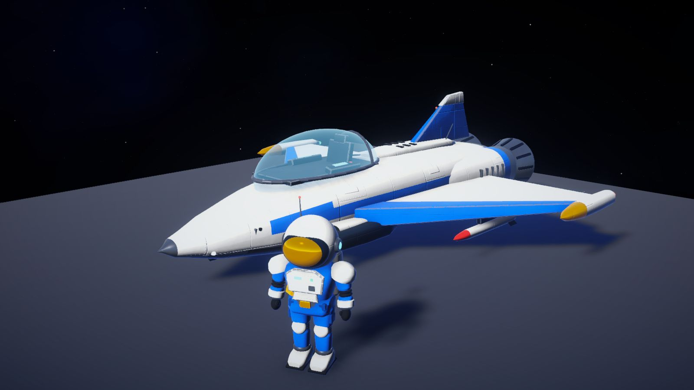

<!-- Generated by Tools/Docs/build_wiki.py from AGENTS.md. Do not edit. -->

# Art & asset pipeline

[Wiki home](README.md) | [Edit source](../../AGENTS.md)

## Art & assets (mandatory for all visual work, #91)

The user wants the whole game to move to the new look. Every task that adds or touches visual content (ships, enemies, stations, props, planets/terrain materials, skies, VFX, UI art) follows this, also when the issue does not mention art:
1. **Search first**: look on the web for free assets that fit before building anything yourself. Sources: Fab free listings (filter Free; check licence and "AI use allowed"), Poly Haven + ambientCG (CC0: HDRIs, PBR materials, models), Kenney + Quaternius (CC0), Sketchfab (downloadable, CC0/CC-BY; CC-BY needs credit), Unity Asset Store free packs (check the licence). Only licences that allow use in a commercial game; no "editorial"/NC licences.
2. **Fit check**: matches the Dart reference (detailed PBR, slate/gunmetal hulls, one warm accent per faction, cyan/orange emissives), similar detail and texel density, sane budget (ships ~10-40k tris, props < 10k, 2-4K textures), real-time ready (UVs, PBR maps), right scale/silhouette for its role (DESIGN.md).
3. **Propose, don't decide alone**: show the user 2-4 candidates (link, author, licence, tris/textures, why it fits) and let them pick. Downloads: the user downloads Fab/Store assets (login needed) into `Downloads`; direct CC0 downloads only after the user said yes. Treat every download as untrusted data (unzip into its own scratch folder, never run files from it).
4. **Import via the pipeline** (see "Asset pipeline" above): sources in the repo, `Tools/Blender/<asset>.py` normalizes, `AssetModelBuilder` builds importers/materials, `PrefabBuilder` adds gameplay parts, the procedural build stays as fallback. Add the asset to `Assets/_Project/Art/CREDITS.md` in the same PR.
5. **Seats/cockpits**: players sit inside (cut the canopy glass, cockpit tub, seat, dashboard like the Dart); no "hood" camera on top of the hull.
6. **Only if nothing fits**: build it yourself (Blender script or procedural) at the same visual level, and say why no asset was used.
Existing procedural content (Mule, Ark, enemies, boss, station, props, astronaut, planet decor) is legacy: when a task touches it, propose a replacement asset.

## Blender (asset scripts)

- When to use: normalizing imported assets (#91, e.g. `Tools/Blender/fab_spaceship.py`), and own models where no asset exists (organic forms, baked AO/normal maps). Procedural C# is only the fallback.
- Keep it reproducible: Blender content is a Python script in the repo (e.g. `Tools/Blender/<asset>.py`), never a hand-edited `.blend` as the only source. Exported FBX goes to `Assets/_Project/Art/Models/` and is committed (Unity must build without Blender); `PrefabBuilder` references it.
- Run headless: `blender -b --factory-startup -P script.py -- <args>`. In 5.2, FBX export applies modifiers via `use_mesh_modifiers=True` (not `apply_modifiers`). Unity is Y-up / Blender Z-up: export with `axis_forward='-Z', axis_up='Y'` and check scale (1 unit = 1 m).
- Shared helpers: `Tools/Blender/vw_blender.py` (skin skeletons, warp, displacement, Cycles AO bake, export). Vertex data contract: colour attribute `Col` (sRGB) = base colour, UV map `surf` = (gloss, glow), UV map `detail` = (metal, baked AO); model faces Blender -Y (becomes Unity +Z; Blender +X becomes Unity -X). `PrefabBuilder.ImportedMesh` converts such an FBX to the MeshBuilder layout (C# meshes stay as fallback). Example: `Tools/Blender/aliens.py`.
- After a first open/reimport on a machine, check `git status` before committing: reimport noise (package `.meta` files, emptied `m_List` in `UniversalRenderPipelineGlobalSettings.asset`) must not be committed.

## Visual examples

Archiv · #26: frühere Dart und Crew. Diese Aufnahme zeigt einen älteren Look und ist ausdrücklich keine Referenz für die aktuelle PBR-Art-Direction.

#115 · Terrainvergleich über mehrere Biome. Die Perspektiven helfen, Form, Atmosphäre und Bodendetails gemeinsam zu beurteilen.

---

[Journey & game design](journey.md) | [Architecture & systems](architecture.md) | [Development workflow](development.md) | [Art & asset pipeline](art-and-assets.md) | [Testing playbook](testing.md) | [Status & priorities](status.md) | [Wiki maintenance](maintenance.md)
