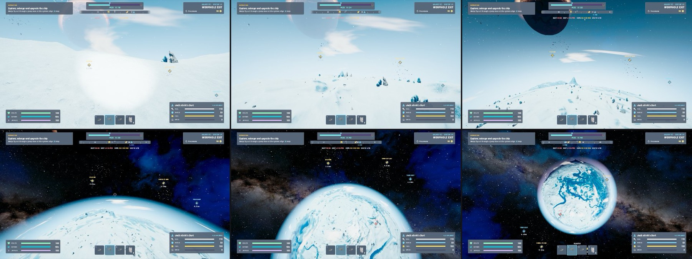

<!-- Generated by Tools/Docs/build_wiki.py from AGENTS.md. Do not edit. -->

# Testing playbook

[Wiki home](README.md) | [Edit source](../../AGENTS.md)

## Testing playbook (dev harness, #65)

Goal: test the situation, not a whole run, and keep tool output small. Harness = `Scripts/Dev` (`Voidward.Dev`, editor + development builds only).
- **Pick the cheapest level**: shader/particle look → Edit Mode (render a quad / `DevShots.Shot(name, pose)` works outside Play Mode) or the Lab; gameplay in context → `QuickStart` + a few shots; MP only when RPCs/NetworkVariables/authority changed.
- **Start** (one RunCommand line from Edit Mode, survives the domain reload): `Voidward.Dev.DevTest.Play(Voidward.Dev.DevScenario.Lab)`; then `bash Tools/Dev/dev-wait.sh quickstart` (no sleeps). Scenarios: `Space` (pilot seat), `Planet` (on foot, sunlit dry ground, blaster, god mode), `Lab` (5 test walls Metal/Rock/Dirt/Organic/Shield next to the trader station, same on every peer), `Galaxy` (pilot seat, galaxy map open). Already playing: `DevTest.QuickStart(...)`. Humans: menu `Voidward/Dev/Play: ...`.
- **Act**: `DevTest.Fire(kind, from, to)` (server, dmg 0), `Hitscan(from, to)`, `PawnShoot(target, rifle)` + `GroundAhead(dist, side)`, `SpawnEnemy(kind, pos, lookAt)`, `Teleport`, `God`, `ClearDecals`, `DecalCount`; damage taken: `HurtPawn(amount, fromDir)` / `HurtShip(amount, fromDir)` (server hit from a world direction, ignores god mode; ship = shield first), `SetVitals(health01, shield01)`; lab: `LabTargets[i]`, `LabGun(i)`, `LabCam`, `LabClose(i)`.
- **Journey (#46)**: `GotoGalaxy(g, s)` / `GotoSystem(s)` (server, instant warp, logs `[Dev] end goto <SystemInfo>`), `SystemInfo` (galaxy, system, kind, planets, visited, run time), `GalaxySystems` ("0:Planetary 1:Nomads ..."), `SaveRun()` / `HasRunSave`; continue test: `ServerReturnToLobby()` then `SessionManager.Instance.ContinueRun()`. Ending a run (`EndRun`) records it in the real meta save: `BackupMeta()` first, `RestoreMeta()` after.
- **Warp drive (#78)**: `SetDrive(tier)` / `SetDrive(core, nav, cooling, tank)`, `SetFuel(x)` (server), `DriveInfo` ("core 2 nav 2 cool 1 tank 1 | exotic 4/12 | next 10:00 (8) skip ... home ... | factor 1.08"); warp with `RunManager.Instance.ServerWarp(RunManager.WarpNextGalaxy / WarpSkipGalaxy)` (aborts without fuel unless god mode). MP: with `-devshots` the client also logs `[Dev] client<id>_<t> galaxy G drive <DriveInfo>` (compare with the host). Pure ETA numbers need no Play Mode: `DriveMath.Compute(ContentCatalog.Instance.WarpDrive, ...)` in Edit Mode.
- **Warp flight (#79)**: scenario `Warp` (lead pilot in a flown warp M33 -> M31, Mk II, cruising 60 %). `StartWarp(target)` (server, skips countdown, loads the fuel it needs; logs `[Dev] end warp <WarpInfo>`), `WarpInfo` ("1 -> 2 | 34.2/210.0 km 16% GALAXY HALO | throttle .. heat .. cruise .. stall .. hot .. | lead .. hazard .. | out .. | exotic .. | scan .. | destroyed .."), `WarpSegment(WarpZone)`, `WarpAhead(WarpHazard, dist)` (next obstacle of a kind `dist` m ahead), `WarpSignalAhead(dist)`, `WarpProgress(0..1)`, `SetThrottle(t, cruise)`, `WarpLeadTo(y, z)` (lead ship to a lateral lane), `WarpDropOut()` (server, as [G]: drop out at the signal in range / start the 5 s resume countdown; works without editor focus), `WarpPatrolAhead()` (bubble just before the next interceptor patrol chunk; they spawn once it moves). Slingshot test: hold the lead on a lane 2x the well radius beside a gravity well with a `Sequence` step calling `WarpLeadTo` + `SetThrottle` each frame (unpiloted, the well's pull drags the ship into the core). Server log: `[Warp] begin/impact/slingshot/arrived`. A route is pure: `new WarpRoute(seed, from, to, length)` works in Edit Mode. MP: the client log line also carries `| warp <WarpInfo>`.
- **Cruise / hops (#80)**: `Cruise(on, force)` (local pilot, skips the spool-up; respects the locks unless forced), `CruiseInfo` ("cruise Cruising 993/1000 m/s | clear 2311 m Planet(Clone) | block - | spool 1.00"), `SeatShip`, `ShipsCruise` ("111:Cruising:993 112:Off:0", also in the MP client log line), `FacePlanet(i, clearance)` (server: ship `clearance` m outside planet i's gravity lock, nose on it; negative = inside), `StartHop(system)` (server, skips countdown and locks; logs `[Dev] end hop <WarpInfo>`). The real spool path: call `SeatShip.Flight.SetCruiseInput(held, pressed)` per frame in a `Sequence`. Warp lock: a jump zone with an engaged enemy near it shows `Combat` in `JumpZoneInfo`. Server log: `[Warp] begin 1 -> 1 system s`, `[Warp] arrived at system s`, `[Warp] interdicted: ...`.
- **Jump zones (#108)**: `JumpZoneInfo` ("entry - veil 0.00 crew-missing 0 align -1:0.00 | 0:Hop>1 Open @5.0km 1:Rim>-1 Fuel @6.9km ..."), `FaceJumpZone(zone, distance)` (server: local pilot's ship `distance` m before the zone plane, nose outward; negative = past it), `FlyOutJumpZone(zone, cruise, timeout)` (the real path: in front of the zone, then cruise through or, cruise false, sit just past the plane aligned for the 3 s timer; logs `[Dev] end jump after n s | <WarpInfo>` or FAILED with the zone state). Crew rule: `Pawn.CurrentShipSeat.RequestLeave()` -> every zone `Crew`; re-seat with `Board(ShipClass.Dart)`. Fuel hold: `GotoSystem(last)` + `SetFuel(0)` + `FlyOutJumpZone(rim)` -> FAILED, HUD "JUMP ZONE HOLDS". Exit: during a flight `ServerSetProgress(Length - 500)`, then `CruiseInfo` / `JumpZoneInfo`. Server log: `[Jump] entry: ...`, `[Jump] rebased into the bubble around ... (n more ships)`, `[Warp] out of the bubble at ... (from system s)`. `StartWarp`/`StartHop`/`GotoSystem` keep the instant dev path.
- **Flight home (#81)**: scenario `Finale` (lead pilot in the flight home LMC -> Sol, Home Drive, cruising 80 %). `StartFinale(tier)` (server, goes to galaxy 5 first, all parts at `tier`; logs `[Dev] end finale <WarpInfo>`, `WarpInfo` ends with `finale from x km`). A pilotless lead stalls on the first collision: `God(true)` + `WarpProgress(0.9995)` + `SetThrottle(1, true)` reaches the arrival (`[Warp] arrived at stop 6`, results screen); `BackupMeta()`/`RestoreMeta()` around it (the homecoming writes the meta save).
- **Failing (#145)**: `KillCrew()` (server: every pawn takes a lethal hit = the real death path; waits until all stand again in the cryo pods; logs `[Dev] end killcrew <RunInfo>`), `RunInfo` ("Playing seed .. | log 2 | screen None | best galaxy 1"), `Logbook` (server, one entry per line), `DownPawn()` (local pawn down; `[Dev] end down <DownInfo>`), `Revive()`, `ReviveHold(seconds)` (as if a crewmate held [F]), `DownInfo` ("down True bleed 41.2 revive 0.33 hp 0/100 oxygen 90"), `FailLanding()` (every pawn struck down; `[Dev] end faillanding <WreckInfo>`), `WreckInfo` ("wrecks 1: 98:Dart owner none hull 110/110 cargo 8 | <DownInfo>"); landing test: scenario `Planet`, `ServerUndock(false)` + `ServerTeleport` the Dart next to the pawn first (it starts docked), then `FailLanding()`; a pawn that woke inside the Nostos is not in the landing party. `DestroyHome()` (Nostos to 0 hull = disabled; `[Dev] end destroyhome <HomeInfo>`), `RepairHome()` (disabled -> repaired without paying; `[Dev] end repairhome` has no begin marker). The real repair path: `ShipCore.ClaimServerRpc` at the Nostos terminal with 120 Salvage.
- **Loot / music / meta (#43)**: `DropLoot(id, from, count)` (server; pops out of `from` like an enemy drop), `DropRarityRow(from)` (one item per rarity, ids in `RarityItems`), `LootCount`, `LootMagnetized`, `ClearLoot()`; music: `SetThreat(level01, boss, seconds)` (client override of `Threat`, -1 clears), `MusicState` / `LogMusic(tag)` (threat + combat/boss stem mix); meta: `BackupMeta()` -> `AddMemories(n)` -> ... -> `RestoreMeta()` (the meta save is the real local save). Currency (#112): `SalvageInfo` ("0:80 1:105", also in the MP client log line as `| salvage ...`). Perk unlock UI: push `UIRoot.Instance.Push(Screen.Hangar)` from the main menu and invoke an `Unlock (..)` button's onClick inside a `Sequence`.
- **Planets (#70)**: `DevTest.PlanetSurvey(name, shapes, views, radius, seed)` (play mode, any phase) builds each `PlanetShapeDef` as a temporary planet far outside the sector, drives the main camera through the `PlanetView` flags (Orbit, Limb, Flight 300 m, Ground, Shore) so LOD/decor/ambience react like in game, and writes ONE sheet (row = shape, column = view, no HUD). Shapes: `DevTest.CatalogShapes()` or load `Data/Planets/Planet_<id>.asset` via AssetDatabase. Use it as before/after for any planet shader or preset change. `PlanetView.Ground | PlanetView.Shore` with 4 shapes = a sheet readable at full size. `DevTest.TerrainLayerCost(seconds)` = frame time with the PBR layers on vs off at the current view (`[Dev] end terraincost on X ms off Y ms`, editor numbers: compare only).
- **Low-poly ships (#122)**: Edit Mode `ContentBuilder.PreviewLowPoly("Dart"|"Mule", cams[], targets[], fov)` builds the ship without saving any prefab and renders `Temp/HeroShots/<ship>_LP_<i>.png` (camera/target in ship space), then reopens `Voidward.unity`. Single prefabs must not be saved on their own (SavePrefab recreates the asset: new GlobalObjectIdHash), so ship changes end with Build All Content.
- **Cockpit (#94)**: `DevTest.PilotView(name)` renders the player's current view (main camera pose + FOV, no HUD) at 1920x1080 to `%TEMP%/VoidwardDev/name.jpg` (judge display readability there, the editor game view is tiny); `DevTest.InteractPrompt` = the local pawn's [F] prompt. `DevTest.CockpitViews(name)` = one sheet of four views from the seated eye (back over the seat, left shoulder, up through the canopy, right console). Seat test: `Pawn.CurrentShipSeat.RequestLeave()`, then `Teleport` around the ship (feet = eye - up x 1.62) inside a `Sequence` and log `InteractPrompt` per spot.
- **Mule / Ark (#97)**: `DevTest.Board(ShipClass, role, claim, index)` (server: the local player sits in the index-th seat of that role of a ship of that class, a working one before a derelict; spawns one 45 m beside the player's ship if none exists; claim = restore a derelict first; logs `[Dev] end board ...`), `SetDerelict(cls, on)` (server, ShipDerelictLook test). `CockpitViews` / `SeatBodyViews` take the occupied seat's view point when no eyeZ is given (Mule eye (0, 0.55, 3.3), Ark (0, 0.2, 14.6)). Mule as warp lead: `Board(ShipClass.Mule)` then `StartWarp()`. Walk test inside the Ark: leave the seat, then `Teleport` to ship-local spots in a `Sequence` (repeat `RequestLeave` while still seated after boarding two ships) and log `InteractPrompt`; deck floor y -1.55, pilot platform -1.16. After an editor restart check the active scene (`Voidward.unity`): an empty Untitled scene starts a run without players (`end quickstart FAILED: no local pawn`).
- **Home ship Nostos (#49)**: scenario `Nostos` (at the Nostos helm, own Dart docked; `Space`/`Lab`/`Galaxy` launch the Dart first, `Warp`/`Finale` board the Nostos). `HomeInfo` ("Nostos hull 990/990 shield 380 | clamps 0:84 1:- 2:- 3:- | pods 4 | disabled False | pilot 0 | me Dart docked 0"), `Launch()` / `Dock(clamp)` (server, the local player's ship), `CryoTest()` (lethal hit, waits for the cryo wake-up; `[Dev] end cryo pod i at d m | inside True ...`), `DestroyHome()` (disables the Nostos). Real dock path: seat in the Dart, `Launch()`, then put it a few m above a free clamp with zero velocity and call `Flight.SetPilotInput(zero...)` every frame in a `Sequence` (the clamp grabs it). Leave a docked Dart's seat -> the pawn stands at the clamp's hatch inside. Heavy landing: put the Nostos 80 m over the ground with -30 m/s while piloted and log `Flight.Altitude` + the descent. Edit Mode: `ContentBuilder.PreviewShot("Ship_Nostos", camLocal, targetLocal, fov, name)` (deck y -2.33; hall z -9.4..6.4, cryo 6.4..9.9, bridge 9.9..25.3, engine room -16..-9.4).
- **Crew body (#95)**: `DevTest.BodyViews(name)` (the local on-foot body as others see it, 4 views incl. the tool hand), `DevTest.WalkViews(name)` (scenario `Planet`: carried along the ground at walk/jog/sprint/backwards, one tile each, wait with `dev-wait.sh name`), `DevTest.SeatBodyViews(name)` (seated body from outside: side, front, stick hand, throttle hand), `DevTest.CrewInfo` ("0:Ground/1/0 6.0 Move 1:seat Pilot Sit", also in the MP client log line as `| crew ...`). `GroundAhead` ignores the pawn's own colliders. Body renderers of the owner only cast shadows: the view helpers switch them on for the shot.
- **Enemies (#98)**: `DevTest.SpawnEnemy(kind, pos, lookAt)` per type (Planet scenario: `GroundAhead(dist, side)`), `DevTest.SpawnWarden(ahead)` (server: the real enclave wake-up path anywhere, 260 m ahead of the local ship; logs `[Dev] end warden <pos>`). Edit Mode: `ContentBuilder.PreviewClips(prefab, clips, normalizedTimes, camLocal, targetLocal, fov)` samples a rigged prefab's clips into `Temp/HeroShots/<prefab>_<clip>_<i>.png` and logs `[Voidward] Preview ... posed bones min/max` (feet near y 0). Check a rig's FBX export by bone positions / bind poses, not by `BakeMesh` (double-scales).
- **World objects (#99)**: `DevTest.SpawnPoi(kind, ahead, side)` (server: "Ruin", "Crash", "Nest", "Wreck", "Station", "Crate", "Ore"/"Crystal"/"Scrap"/"Fuel" nodes, "Pickup:<item id>" on the ground in front of the pawn; logs `[Dev] end poi <kind> <pos>`); frame a shot by the spawned object's renderer bounds (hilly planets make fixed poses useless). Station walk test: scenario `Lab`, `RequestLeave`, `Teleport(station.TransformPoint(0, -6.4, 46), station.up, -station.forward)` -> `InteractPrompt` = "[F] Trade". Crate lid: `LootCrate.Interact(null)` opens only within 8 m of the host pawn. Edit Mode: `ContentBuilder.PreviewShot("TraderStation" | "Wreck" | "Ruin" | ...)`.
- **Light / sky / VFX (#96)**: `DevTest.ShipViews(name)` (seated ship from outside: front three-quarter, rear, wide with the sky, close along the hull), `DevTest.VfxViews(name, distance)` (explosion, muzzle burst, metal/rock/laser impacts, shield hit/break in front of the ship, 6 tiles over 2.5 s; use distance ~22 to judge them; wait with `dev-wait.sh name`). `DevTest.ProjectileViews(name)` (scenario `Space`, server: laser, enemy laser, blaster, missile, flak, boss orb fly across a side camera, 4 tiles over 0.4 s). Reflections: put URP/Lit metal spheres (metallic 1, smoothness 0.95/0.7/0.4) in front of the ship and `Shot` them.
- **Look**: `DevTest.Sequence("name", seconds, (frame, t) => {...}, new[] { 0.1f, 0.5f, 2f }, DevTest.LabCam)` runs the step every frame and writes ONE contact sheet (640x360 tiles; pose = free camera, omit it for the player's screen incl. HUD) to `%TEMP%/VoidwardDev/name.jpg`; wait with `dev-wait.sh name`. Read sheets instead of many full screenshots. `DevTest.Screen(name)` = single downscaled screen grab.
- **Log protocol**: every call logs `[Dev] begin <tag>` synchronously and `[Dev] end <tag> ...` (or `FAILED`) when done; `dev-wait.sh <tag> [timeout]` prints the end line (`VW_LOG=<file>` for a client log).
- **Dev build without log flood**: RunCommand `Voidward.EditorTools.DevBuild.WindowsDevQuiet()` (Mac: `MacDevQuiet()`), returns one line; the menu build via RunCommand returns ~150k chars of foreign shader warnings. `EditorApplication.delayCall` does not fire while the editor is in the background, don't rely on it.
- **MP**: `DevTest.Play(DevScenario.Lab, 2)` (host waits for 2 players), then `bash Tools/Dev/mp-client.sh lab 3` (dev build with `-autojoin -skipintro -devscenario=lab -devshots=3`; it renders the lab camera every 3 s and logs `[Dev] client1_<t> decals N` into `%TEMP%/VoidwardDev/client.log`). Compare host/client via log lines, look at one client image at most. Stop: `Stop-Process -Name Voidward` / `pkill -f Voidward.app`.
- Write a test step as a small RunCommand using the harness; if a helper is missing, add it to `DevTest` instead of pasting long ad-hoc scripts.
- **Keep the harness growing**: when a feature brings its own typical test steps (e.g. spawn a boss phase, open a crate, dock at a station), add them as `DevTest` helpers or a new `DevScenario` in the same PR, so later issues reuse them. Document every new helper, scenario or flag here (one line is enough) - this section is how the next session learns about it.

## Visual examples

#115 · Kontaktbogen eines Eisplaneten: Boden, Flug und Orbit in einer Übersicht. Ein vorhandenes Prüfartefakt, kein Nachweis für einen neuen Testlauf.

---

[Journey & game design](journey.md) | [Architecture & systems](architecture.md) | [Development workflow](development.md) | [Art & asset pipeline](art-and-assets.md) | [Testing playbook](testing.md) | [Status & priorities](status.md) | [Wiki maintenance](maintenance.md)
